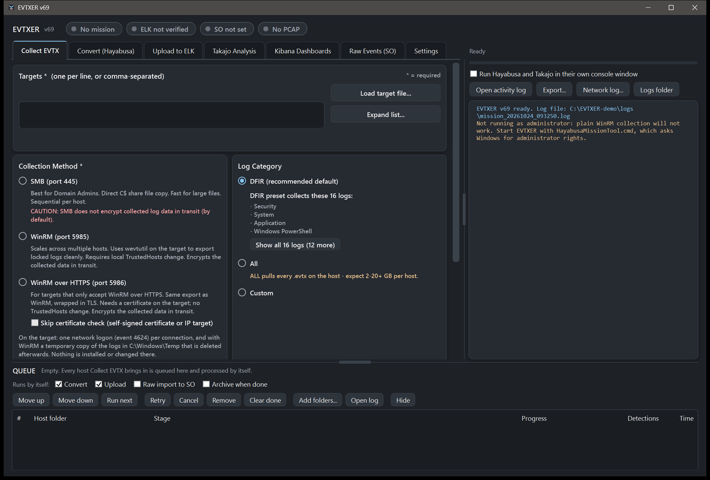
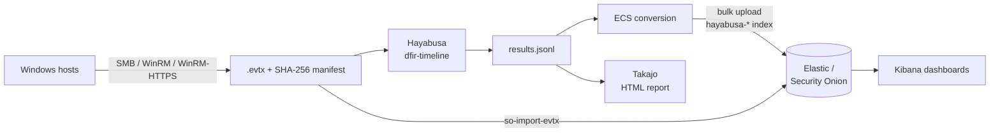

  

<h1 align="center">EVTXER</h1>

  <b>Collect Windows event logs, hunt them with Hayabusa, and land the detections in Elastic - from one window.</b>

  
  
  
  

  

EVTXER is a Windows tool for incident responders and threat hunters. It pulls
`.evtx` logs from remote hosts, scans them with
[Hayabusa](https://github.com/Yamato-Security/hayabusa)'s 5,000+ Sigma-based
rules, analyses the results with
[Takajo](https://github.com/Yamato-Security/takajo), and uploads the detections
to **Security Onion** or any **Elastic** stack - with ready-made Kibana
dashboards to hunt in.

It is plain PowerShell 5.1 and WPF: **no Python, no installer, no internet
needed.** Copy the folder, double-click, work.

## Features

- **Collect** - SMB, WinRM, or WinRM over HTTPS. A DFIR preset of 16 logs or
  every log. Each file is SHA-256 hashed into a manifest, copied as `.partial`
  and renamed only when complete. The tool measures and reports what a
  collection leaves on the target (one network logon; with WinRM a temporary
  copy that is deleted), and refuses a host whose disk would run low.
- **Scan** - Hayabusa `dfir-timeline` in UTC, converted to ECS-shaped JSON with
  every event field under `winlog.event_data.<Name>`.
- **Upload** - streamed bulk upload into a dedicated `hayabusa-*` index (never
  into the stack's own indices). Every detection gets a stable id, so a
  re-upload adds only what is new. TLS certificates are pinned.
- **Hunt** - nine Kibana dashboards and nine saved searches: overview, hunting,
  MITRE ATT&CK, PEAK threat hunting, anomaly hunts (rare, new, off-hours,
  fan-out, wrong-place, long command lines) and per-host links. Exports for
  Kibana 9 and 8.7.
- **Raw events** - send the `.evtx` files to Security Onion's own importer, so
  every event is searchable beside the detections.
- **Takajo** - CSV results or an offline HTML report, opened from disk.
- **Queue** - each collected host runs scan, upload, raw import and archive by
  itself, in the background, one step at a time.
- **Accountability** - an append-only activity log of every action that
  touched a target or the stack, and an optional PCAP of the session.
  Passwords are never written to disk, logs or command lines (an opt-in
  "remember" uses Windows DPAPI).

## How it works

## Quick start

1. **Get the folder.** Clone this repository (or download it as a zip).
2. **Add the bundled tools** - they are not in git:

   | Folder | Put here |
   |---|---|
   | `code/hayabusa-x64/` | The contents of `hayabusa-4.2.0-win-x64.zip` from [Hayabusa's releases](https://github.com/Yamato-Security/hayabusa/releases/tag/v4.2.0) (the x64 build, with its `rules/` and `config/`). |
   | `code/takajo/` | The contents of `takajo-2.16.1-win-x64.zip` from [Takajo's releases](https://github.com/Yamato-Security/takajo/releases/tag/v2.16.1). |
   | `code/putty/` | `plink.exe`, `pscp.exe` and PuTTY's `LICENCE` from [PuTTY](https://www.chiark.greenend.org.uk/~sgtatham/putty/) - only for the Raw Events tab. |

3. **Run it.** Double-click `EVTXER.cmd`. It starts PowerShell
   with the execution policy bypassed for that one process only, and asks
   Windows for administrator rights once (plain WinRM needs them; SMB and
   WinRM-HTTPS work without).
4. **Read the manual.** [README.txt](README.txt) is the operator guide: every
   tab, what a collection leaves behind, Security Onion and plain-Elastic
   setup, and manual procedures if something breaks.

Requirements: Windows 10/11 x64 with the built-in Windows PowerShell 5.1. The
target side needs nothing installed.

## Elastic and Security Onion

- **Security Onion 2.4** - upload, dashboards (imported by the tool) and raw
  `.evtx` import all work.
- **Plain Elastic (8.7 and 9.x)** - upload works; import the dashboards by
  hand. [kibana/ELASTIC-SETUP.txt](kibana/ELASTIC-SETUP.txt) creates a
  least-privilege upload role and user, and [kibana/IMPORT.txt](kibana/IMPORT.txt)
  covers the dashboards.

## Development

| Path | What it is |
|---|---|
| `code/` | The tool: launcher, engine (`HayabusaLib.ps1`), collector, one `wpf-*.ps1` per tab, `assets/`, `licenses/`, `index-template.json`. |
| `kibana/` | Dashboard exports (Kibana 9 and the generated 8.7 file) and setup notes. |
| `scripts/` | Python dashboard generators, the 8.7 converter, and `hayabusa_to_ecs.py` - the Python twin of the ECS conversion, kept in step by tests. |
| `tests/` | The suite: `powershell -File tests\run-tests.ps1`. Plain assertions, no Pester. Live tests run only when their `TEST_*` variables are set. |
| `tools/dev/` | Helpers for GUI driving, Hayabusa comparisons and dashboards - see its README. |

Sample event logs are not in the repository. Put public samples (for example
[EVTX-ATTACK-SAMPLES](https://github.com/sbousseaden/EVTX-ATTACK-SAMPLES)) in
`evtx-samples/` to run the scan tests; they skip without them.

## Use responsibly

EVTXER logs on to the hosts it collects from with the credentials you give it.
Use it only on systems you are authorised to examine.

## Licence

EVTXER is released under the [MIT License](LICENSE).

It runs, unmodified and as separate programs, **Hayabusa** and **Takajo** by
[Yamato Security](https://github.com/Yamato-Security) (GNU AGPLv3) and
**PuTTY** by Simon Tatham (MIT). The detection rules are under the Detection
Rule License 1.1. [code/licenses/NOTICE.txt](code/licenses/NOTICE.txt) lists
every third-party component; that folder holds their licence texts and the
source of the Hayabusa and Takajo versions EVTXER is built for.
